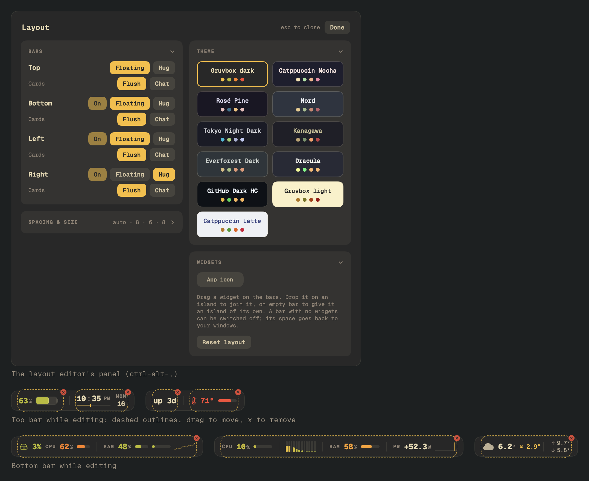
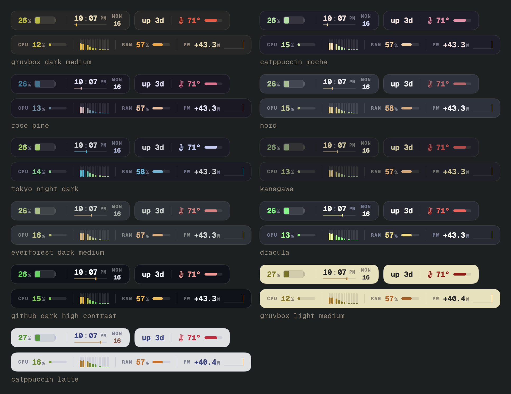

# riskell

**A desktop shell framework for macOS.**

riskell provides the building blocks of a desktop shell (status bars, hover cards, a workspace overview, riskell preferences (a layout editor), themes and window
manager integration) in one native Swift application, together with an extension system for adding to them. Extensions are written by
people or by their coding agents, checked by a command line validator, and shared as ordinary Swift packages.

The project began as a port of a Quickshell setup from Linux. It works alongside a tiling window manager and does not replace one;
[OmniWM](https://github.com/OmniNull/OmniWM) is the reference integration.


*The shell on a 14-inch MacBook Pro. The bars are snapshots of the running application; the windows between them are placeholders.*

> **Status: pre-release.** riskell is in daily use on one Mac. Other Macs, window managers and macOS versions are untested, and the
> extension system is new. [What is tested and what is not](#what-is-tested-and-what-is-not) lists each case.

**Contents:**
[Architecture](#architecture) ·
[Features](#features) ·
[The shell in pictures](#the-shell-in-pictures) ·
[Extending riskell](#extending-riskell) ·
[Requirements](#requirements) ·
[Installation](#installation) ·
[Usage](#usage) ·
[Window managers](#window-managers) ·
[Resource use](#resource-use) ·
[Data access](#data-access) ·
[Test status](#what-is-tested-and-what-is-not) ·
[Planned](#planned) ·
[Troubleshooting](#troubleshooting) ·
[Documentation](#documentation) ·
[License and contributing](#license-and-contributing)

---

## Architecture

riskell has two parts. The **shell** is the application: it owns every window and draws the surfaces. The **framework** is what extensions
build on: a small public package, [RiskellKit](https://github.com/rish139/riskell-kit), that provides the design tokens, drawing parts and extension API, so that anything written
against it matches the shell in every theme and at every screen size.


| Surface | State | What extensions can add to it |
|---|---|---|
| Bars (top, bottom, left, right) | built | atoms: widgets that sit in islands |
| Hover cards | built | the card an atom opens |
| Workspace overview | built | not yet |
| riskell preferences (layout editor) | built | the EXTENSIONS card: settings an extension declares in its manifest |

Design rules that apply to the shell and to every extension:

- **Native.** Swift and SwiftUI, with no web views and no second runtime.
- **Event-driven.** Nothing polls without a reason, and nothing runs for a surface that is not showing.
- **Consistent.** Colours, type and sizes come from the theme and from one scale factor, so a widget looks the same on every display.
- **Valid by construction.** The extension API has no way to express an unreadable colour, a fixed pixel size or a stray timer, and
  `risk ext validate` reports any attempt with the fix.
- **Readable by machines.** A JSON Schema for the manifest, a generated API reference and task-oriented documentation allow a coding agent
  to write an extension and check it without guessing.

riskell is not a window manager and does not tile windows. It is not only a launcher, and it is not a collection of fixed widgets.
SketchyBar is configured through shell scripts and Übersicht widgets are written in HTML and JavaScript; riskell takes the
shell-framework approach known from Quickshell and AGS on Linux and applies it to macOS with typed, native extensions.

---

## Features

**The shell**
- Four bars: top, bottom, left and right. Each is a solid "hug" band with concave fillets, or a set of floating islands, and each can be
  switched off. The right bar is off by default.
- Islands hold one or more atoms separated by a hairline. Start, centre (bottom bar only) and end zones are filled independently.
- A notch-aware top bar with one wing on each side that always fits. On a Mac without a notch the bar sits under the menu bar with a
  stand-in gap.
- Now-playing media in the notch wings: the application icon on the left and play and pause on the right, shown while media plays and
  for a short time after it pauses.
- Windows stay clear of the bars: riskell keeps OmniWM's outer gaps in step with the bars that are on.
- The bars live in a private SkyLight space, so they do not move when the Space changes, and they hide on native full-screen Spaces.
- Hover cards in two styles, flush or chat, chosen per bar. Cards open on hover, can be pinned open with a click, and close on click-away.
- Island gap, edge gap, window gap and corner roundness are adjustable.

**Built-in atoms**
- Workspaces, application icon, clock and calendar, battery, CPU, memory and power, fans, volume and microphone, network, weather and AI
  usage.
- Every atom has a horizontal form and a vertical form with the same content and the same card, so any atom can sit on any bar.
- A version pill in the top bar that appears only when something needs attention ([COMPATIBILITY](docs/COMPATIBILITY.md)).

**Layout and themes**
- A drag-and-drop layout editor with a tray of unplaced atoms, collapsible sections, spacing and scale controls and a reset.
- Eleven bundled themes with enforced contrast, a live picker, and drop-in Base16 files.
- Settings apply live from kernel file events: edits to `config.json` take effect within about a third of a second.

**Workspaces and windows**
- A workspace overview with live window pictures, a slot for a new workspace, a find-as-you-type field, drag-and-drop of windows between
  workspaces and middle-click to close a window.
- OmniWM integration over its IPC socket, with no polling. Backends for yabai, AeroSpace and custom commands are written and untested.
- Optional three-finger gestures: sideways to switch workspace with the rail following the fingers, up for the overview, and a scroll
  guard. Conflicts with macOS's own gestures are detected and reported.

**Script pills**
- A widget from any command, with no build step. Output is text or JSON: an SF Symbol, a tone, a gauge, up to three further figures, a
  sparkline, and a hover card of lines or a two-column grid.
- Scheduled (`every`), event-driven (`watch` a file) or streaming (`stream`, one long-running process). A click can run a command.
- Drop-in files in `~/.config/riskell/pills/`, applied live.

**The framework**
- [RiskellKit](https://github.com/rish139/riskell-kit): an Apache-2.0 Swift package in its own repository, with design tokens, drawing parts, the reading renderer and the extension API.
- Four extension kinds: pills, themes, reading atoms and custom atoms. Compiled extensions are linked into the one binary, run only while
  their atom is showing, and match every theme.
- `risk ext`: validate, scaffold, install and remove extensions. A JSON Schema for the manifest, a generated API reference, an
  `AGENTS.md` for coding agents, and a working example.

**Operation**
- A guided terminal installer with a dry run, a no-questions mode and an uninstaller.
- `risk`: install, dev (rebuild and restart), restart, log, status, ext (extensions), uninstall, and OmniWM helpers. The installer puts it on
  the PATH.
- A Unix socket for scripting, and a measured efficiency record with a method for repeating the measurement.
- Display handling: one scale factor from the notch or menu bar height, a live display-change observer, fake displays for testing, and
  `--check-fit` and `--check-panel` reporting PASS or FAIL.

---

## The shell in pictures

### Atoms and hover cards

An atom is one widget. Hovering an atom opens its card. All cards below are shown in the flush style, hanging from the top bar: the bar
fills in beneath the card so that the two read as one surface. The chat style, a rounded card joined to the island by a short neck, can
be selected per bar.


| Atom | Shows | Card |
|---|---|---|
| Workspaces | the window manager's workspaces as a rail of beads | every workspace with its windows; drag to move a window |
| Application icon | the focused application's icon and name | |
| Clock | time, a seconds bar and the date | calendar |
| Battery | charge level and a charging cell | power, temperature, health, cycles, charger, energy |
| CPU | load, per-core bars, memory, power draw | load history, per-core bars, memory, storage, the busiest applications |
| Fan | rpm and temperature | fan dials, temperatures and a 30-minute sensor history |
| Volume | output level and microphone level | output and input devices and a per-application mixer |
| Network | Wi-Fi signal | Wi-Fi details and nearby networks, with Bluetooth and VPN tabs |
| Weather | temperature | hourly and daily forecast ([Open-Meteo](https://open-meteo.com)) |
| AI usage | Claude Code and OpenCode usage, when enabled | limits and reset times |

### riskell preferences

**ctrl-alt-,** opens the editor. Every atom receives a dashed outline. Atoms are dragged between islands and bars, dropped on an empty
bar to start a new island, and removed with the **x**. The panel sets which bars are on, whether each is a hug band or floating islands,
the card style, spacing, roundness, scale and the theme. The layout is saved to `~/.config/riskell/layout.json`.



### Themes

Eleven [Base16](https://github.com/tinted-theming/schemes) schemes are bundled: Gruvbox (dark and light), Catppuccin (Mocha and Latte),
Rosé Pine, Nord, Tokyo Night, Kanagawa, Everforest, Dracula and GitHub Dark High Contrast. riskell does not use a scheme's colours as
given. It derives its own tokens and adjusts text and accent colours until they reach a contrast floor against the background, so a
scheme with a faint grey still produces readable text. Any Base16 `.yaml` file placed in `~/.config/riskell/themes/` appears in the
picker, and switching is immediate.


<details>
<summary>All eleven side by side</summary>



</details>

### Script pills

A pill is a widget defined by a shell command. It needs no Swift and no rebuild: it is added to `config.json` or dropped into
`~/.config/riskell/pills/`, and it then appears in the editor's tray, ready to place.


```json
{ "id": "vpn", "name": "VPN", "run": "~/bin/vpn-status", "every": 10, "click": "open -a Tunnelblick" }
```

The command prints one line of text, or one line of JSON with `text`, `icon` (an SF Symbol), `tone`, `value` (0 to 1, drawn as a gauge),
`values`, `spark` and `lines` for the card. `every` is in seconds, with a minimum of 2. `watch` re-runs the command when a file changes,
without polling, and `stream` keeps one long-running process whose output lines are readings. See [docs/PILLS.md](docs/PILLS.md).

### Workspace overview

**ctrl-alt-space** opens the overview: every workspace as a tile in one row, the focused workspace outlined, a slot for a new workspace
and a find field below. riskell's own bars are drawn inside each tile, and a window can be dragged from one tile to another.


### Screen sizes

All sizes are design units. One scale factor, taken from the height of the notch (or of the menu bar on a Mac without a notch), converts
them to points. The picture shows the same layout on three screens; the first two are the same Mac in two display modes.


On a screen with a notch, the top bar is divided into two wings, one on each side of the notch. A wing that is too wide shrinks, down to
80 %. If it still does not fit, its lowest-priority islands are hidden. `riskell --check-fit` prints the result for a set of fake screens.

---

## Extending riskell

There are four ways to add to riskell, from no code to custom drawing:

| Goal | Kind | Build step |
|---|---|---|
| show a number or text from a command or a file | a **pill** | none |
| change the colours | a **theme** (a Base16 file) | none |
| compute a figure, gauge and hover card in Swift | a **reading** extension | yes |
| draw a widget with SwiftUI | an **atom** extension | yes |


An extension is a Swift package that depends on **RiskellKit** and is compiled into the single riskell binary. There is no second
process: the extension is native, costs nothing while its atom is not showing, and receives its colours, type and sizes from the kit.

```sh
risk ext new reading my-widget     # scaffold a package
risk ext validate my-widget        # check it; each finding names the fix
risk ext add my-widget             # link it in, rebuild and restart
```

<details>
<summary>A reading extension</summary>

```swift
import RiskellKit

public enum GpuPackage: RiskellPackage {
    public static var readings: [any ReadingAtom.Type] { [Gpu.self] }
}

public struct Gpu: ReadingAtom {
    public static let meta = AtomMeta(id: "gpu", name: "GPU", priority: 4)
    public init() {}
    public func readings(_ env: Env) -> AsyncStream<Reading?> {
        env.every(.seconds(5)) {
            let load = probe()                       // the extension's own code; nil means nothing usable
            return Reading(text: "\(Int(load * 100))", icon: "cpu", tone: .heat(load), value: load,
                           lines: ["Load \(Int(load * 100)) %"])   // the hover card
        }
    }
}
```

The kit draws the row on the horizontal bars, the column on the strips, the gauge and the card. A `Reading` has no colour parameter. It
carries a tone (`.ok`, `.warn`, `.crit`, `.accent`, `.heat(x)` and others), and the theme chooses the colour. This is why an extension is
legible in every theme.

</details>

<details>
<summary>Rules enforced by the validator</summary>

`risk ext validate` prints `file:line: rule <id>: <what>. Fix: <how>.` for each violation.

- **Colours and type come from the kit** (`Pal`, `T`, a `Tone`). A hard-coded `Color` or font size breaks themes and the type scale.
- **Sizes are design units** (`G.pill`, `G.strip`). An extension never reads the screen, so it renders identically at any resolution.
- **Nothing wakes up independently.** `Timer`, `DispatchSource` and `Thread` are not permitted. Extensions use `env.every`, `env.watch`,
  `env.on(feed)` or, for an atom that draws itself, `env.repeating`. riskell cancels these while the atom is not showing.
- **Both forms are required** for an atom that draws itself, so it cannot be registered without a vertical form.
- **No windows.** riskell owns every window.

There is no sandbox and no permission system. A compiled extension runs with the user's rights, as a Homebrew formula or a shell plugin
does, and its source should be read before it is installed.

</details>

<details>
<summary>Sharing an extension</summary>

An extension is a Git repository with a `riskell.json` manifest, and it stays under its author's license and copyright. **Publishing one
requires no agreement and no approval**: tag a release, add the GitHub topic `riskell-extension` (or `riskell-theme`, `riskell-preset`),
and anyone can install it with `risk ext add <repository>`. A curated registry with automated checks is planned
([docs/STOREFRONT.md](docs/STOREFRONT.md)); a listing in it is metadata that points at the author's repository.

</details>

The documentation is written for people and for coding agents. [AGENTS.md](AGENTS.md) states which kind to choose and the rules.
[docs/WRITING-EXTENSIONS.md](docs/WRITING-EXTENSIONS.md) is the walkthrough. The [API reference](https://github.com/rish139/riskell-kit/blob/main/docs/KIT-API.md) is generated from the code,
the manifest has a [JSON Schema](schemas/riskell-extension.schema.json), and `Examples/load-ext` is a complete extension. The design and
the list of unbuilt parts are in [docs/EXTENSION-KIT.md](docs/EXTENSION-KIT.md).

---

## Requirements

- macOS 14 or later on Apple silicon (Intel Macs are not supported), and the Xcode Command Line Tools (`xcode-select --install`). Full Xcode is
  not required.
- The font **Geist Mono** (SIL Open Font License): `brew install --cask font-geist-mono`. Sizes are tuned to it, and without it macOS
  substitutes another font and text widths change.
- A tiling window manager is optional. OmniWM is the one riskell was built and tested with. See [Window managers](#window-managers).

## Installation

The guided installer checks the Mac, asks a few questions, writes the settings and starts riskell:

```sh
git clone https://github.com/rish139/riskell.git && cd riskell
./install.sh
```


Nothing is written until the final screen. The installer links `risk` into a folder on the PATH; when none is writable it adds
`~/.local/bin` to `~/.zshrc` (and to `~/.bash_profile`, `~/.bashrc` and fish's `config.fish` when they exist), in a marked block after a backup.
`--no-path` skips this and `--uninstall` removes the block. `./install.sh --dry-run` shows the plan and the JSON that would be written, and
`./install.sh --yes` accepts the detected defaults without questions. [docs/INSTALL.md](docs/INSTALL.md) lists everything the installer
writes.

To install manually:

```sh
swift build -c release
scripts/risk install      # runs riskell as a launch agent: starts at login and restarts if it exits
```

`risk` also provides `dev` (rebuild and restart), `restart`, `log`, `status`, `ext` (extensions) and `uninstall`; from a checkout that has not
been installed, run it as `scripts/risk`. Builds are signed with a local
certificate named `riskell-dev` when one exists. Without it, macOS asks again for keychain and Location access after every rebuild.

## Usage

### Keys and commands

| | |
|---|---|
| **ctrl-alt-,** | open or close riskell preferences |
| **ctrl-alt-space** | open or close the workspace overview |
| three fingers sideways or up | switch workspace or open the overview (when [gestures](#gestures) are enabled) |

riskell also listens on a Unix socket, so other programs can control it:

```sh
printf settings     | nc -U -w1 ~/.cache/riskell/ev.sock   # the editor
printf overview     | nc -U -w1 ~/.cache/riskell/ev.sock   # the overview
printf bar-right-on | nc -U -w1 ~/.cache/riskell/ev.sock   # switch a bar on or off: bar-<top|bottom|left|right>-<on|off>
printf workspace-3  | nc -U -w1 ~/.cache/riskell/ev.sock   # go to workspace 3
```

### Files

| File | Purpose |
|---|---|
| `~/.config/riskell/config.json` | settings: window manager, theme, scale, spacing, location, usage sources, pills. Applied live except `wm`. See [docs/CONFIG.md](docs/CONFIG.md). |
| `~/.config/riskell/layout.json` | the layout: which atoms are on which bar, hug or floating, which bars are on. Written by the editor. |
| `~/.config/riskell/pills/*.json` | drop-in script pills |
| `~/.config/riskell/themes/*.yaml` | drop-in Base16 schemes |
| `~/.config/riskell/ext/<id>.json` | values for an installed extension |
| `~/.cache/riskell/` | the event socket and the log |

### Gestures

riskell can read the trackpad directly. Three fingers sideways switch workspace while the rail follows the fingers, three fingers up open
the overview, and scrolls are dropped while three fingers are down so that the window under the pointer does not move. Gestures are
**off by default** and are enabled with `"gestures": "riskell"` in `config.json`. They need the Accessibility permission, which macOS
requests once. macOS's own three- and four-finger gestures and OmniWM's workspace swipe must be disabled, because they act on the same
touches; the top bar shows a `FIX` pill for each one still enabled. The installer can disable the macOS gestures, and
`riskell --gestures-restore --yes` re-enables them. See [docs/GESTURES.md](docs/GESTURES.md).

## Window managers

| `wm` value | Status |
|---|---|
| `omniwm` (or `auto` when OmniWM is installed) | In daily use. Workspaces, windows and focus come from OmniWM's IPC. riskell keeps OmniWM's outer gaps in step with the bars that are on by editing `gaps.outer` in its `settings.toml`, after making a backup on the first change. |
| `yabai` | Written from yabai's documentation. **Not tested.** |
| `aerospace` | Written from AeroSpace's documentation. **Not tested.** |
| `command` | The user's own scripts: one prints the state as JSON and others handle focus, move and close ([docs/WM-COMMAND.md](docs/WM-COMMAND.md)). The state side was tested; the action commands were not. |
| `none` | Bars without workspaces. |

## Resource use

Measured on the reference layout on a 14-inch MacBook Pro: about 1 % of one core at idle (0.3 seconds of CPU per 30 seconds), about
105 MB resident and 8 threads. All work is event-driven (file events, sockets, notifications). The remaining timers are the clock's seconds
bar (1 s), the CPU atom (2 s) and a fan read (10 s). Pills and extension atoms run only while their bar is showing, so a bar that is
switched off or hidden by a full-screen Space stops them. The built-in services (weather, Wi-Fi, thermals and others) run whether or not
their atom is placed; changing that is on the [roadmap](docs/ROADMAP.md). The measurements, the profile and the method are in
[docs/EFFICIENCY.md](docs/EFFICIENCY.md).

## Data access

| | |
|---|---|
| Network | Weather from Open-Meteo, only when a location is set. The installer makes one city lookup against Open-Meteo's geocoding service while the name is typed. Nothing else. |
| Keychain | Claude Code usage reads the Claude Code token from the login keychain, only when enabled. |
| Browser data | OpenCode usage reads one session cookie from a browser profile, only when enabled. |
| Accessibility | Only for the optional gestures (the scroll guard). |
| Location | Only so that macOS provides Wi-Fi network names. |
| Files | riskell writes `~/.config/riskell/`, backs up OmniWM's `settings.toml` before the first change to its gaps, and, with gestures enabled, can change two trackpad and Dock settings after saving the originals. |

riskell collects no data and sends nothing to any third party. Personal settings remain in `~/.config/riskell/` and are never part of the
source.

## What is tested and what is not

| | |
|---|---|
| **In daily use** | One Apple-silicon MacBook Pro 14-inch (M1 Max), macOS 27.2 (build 26B123), OmniWM 0.8.0 (IPC protocol 22): the bars, atoms and cards, the editor, themes, pills, the overview, OmniWM integration and the three-finger swipe. |
| **Checked numerically and by rendered pictures** | Other screen sizes and scales, and screens without a notch, using fake displays (`riskell --check-fit`, `--check-panel`). |
| **Written, not tested** | The yabai, AeroSpace and command backends; macOS 14 and 15; a clean-machine install; connecting or disconnecting a monitor while running; dragging windows in the overview at other scales. |

[docs/UNVERIFIED.md](docs/UNVERIFIED.md) lists each untested item with the steps to try it. Reports from other setups are the most useful
contribution at this stage.

riskell depends on macOS interfaces that are not public and may change in any update: SkyLight (pins the bars in a private space),
MultitouchSupport (the swipe) and MediaRemote (now playing, read through the system `perl`). It records the macOS and OmniWM versions it
was last checked against and shows an `UPDATE DUE` pill in the top bar when the installed versions differ.
[docs/COMPATIBILITY.md](docs/COMPATIBILITY.md) lists the dependencies and provides a checklist for use after an update.

## Planned

Nothing here is a commitment, and the order is not fixed. [docs/ROADMAP.md](docs/ROADMAP.md) gives the reasoning.

**Before a wider release**
- [ ] Testing on other Apple-silicon Macs and macOS versions (14 and 15), and with yabai and AeroSpace.
- [ ] A Homebrew tap.

**Framework**
- [ ] A registry and storefront for atoms, themes and presets. The built-in atoms are its first listings: each already has one in
  [`listings/`](listings) (checked against the app by `scripts/listings-check.sh`), and they are being moved out of the application into
  packages, simplest first, as the kit's feeds grow to carry what they read (done: the clock, weather, AI usage, battery, CPU, fans, volume and network, in `Packages/`; left: workspaces and the app icon) ([docs/STOREFRONT.md](docs/STOREFRONT.md)).
  Extensions are pinned to a commit and checked by continuous integration that renders each one on several displays, bars and themes.
- [x] riskell preferences: the layout editor is renamed, and extensions declare typed settings in their manifest (number, switch, choice)
  that appear in its EXTENSIONS card, so an extension needs no settings interface of its own.
- [ ] Preset bundles (layout, pills, theme and extensions together), `risk ext publish` and `risk ext search`.
- [ ] Background-behaviour extensions from outside the application, with a review policy.

**Shell**
- [x] Each built-in service runs only while an atom that needs it is placed on a bar that is on, so nothing runs for an atom that is not used.
- [ ] The notch beyond media: a shelf, quick actions and timers.
- [ ] Draw the clock's seconds bar and the CPU deck with Core Animation layers (about 0.8 % of a core).

## Troubleshooting

<details>
<summary>A gap appears on the right and the top bar shows <code>FIX · OmniWM right gap = …</code></summary>

riskell sets the outer gaps in OmniWM's `settings.toml` to match the bars that are on; a bar that is off leaves a 6-point margin. When the
file contains a different value, usually because a second riskell process wrote its own, the `FIX` pill shows the value it found.
Restoring the number under `[gaps.outer]` in `~/.config/omniwm/settings.toml` resolves it, and OmniWM applies the change immediately.

A second instance started for testing must be given `--no-reserve` as a separate argument. That flag prevents the instance from
rewriting OmniWM's gaps. The harness described in `docs/BARS.md` passes it.

</details>

<details>
<summary>Text looks wrong or too wide</summary>

Install Geist Mono (`brew install --cask font-geist-mono`) and restart riskell. Without it macOS substitutes another font.

</details>

<details>
<summary>macOS repeatedly asks for keychain or Location access after a rebuild</summary>

A rebuild without a stable signature appears to macOS as a new application. Create a self-signed code-signing certificate named
`riskell-dev` in the login keychain (Keychain Access, Certificate Assistant), and `scripts/risk` will sign builds with it.

</details>

<details>
<summary>The bars do not appear after starting riskell</summary>

`scripts/risk status` shows whether the launch agent is running, and `scripts/risk log 50` prints the last 50 log lines. A second full
instance cannot start while another holds the lock (`~/.cache/riskell/riskell.lock`); test instances started with `--snap`, `--dump` or
`--no-reserve` are exempt.

</details>

<details>
<summary>Gestures do nothing, or macOS and riskell both respond</summary>

Look for `FIX · gesture: …` pills in the top bar. Each names a setting that is still enabled and conflicts with riskell's swipe. The
scroll guard also needs the Accessibility permission; until it is granted, riskell retries every 3 seconds.

</details>

## Documentation

| | |
|---|---|
| Using riskell | [BARS](docs/BARS.md) (bars, layout, editor, snapshots) · [CONFIG](docs/CONFIG.md) · [PILLS](docs/PILLS.md) · [THEMES](docs/THEMES.md) · [GESTURES](docs/GESTURES.md) · [INSTALL](docs/INSTALL.md) |
| Window managers and compatibility | [COMPATIBILITY](docs/COMPATIBILITY.md) · [WM-COMMAND](docs/WM-COMMAND.md) · [UNVERIFIED](docs/UNVERIFIED.md) |
| Extending | [AGENTS](AGENTS.md) · [WRITING-EXTENSIONS](docs/WRITING-EXTENSIONS.md) · [KIT-API](https://github.com/rish139/riskell-kit/blob/main/docs/KIT-API.md) · [EXTENSION-KIT](docs/EXTENSION-KIT.md) · [STOREFRONT](docs/STOREFRONT.md) |
| Working on riskell | [ARCHITECTURE](docs/ARCHITECTURE.md) · [EFFICIENCY](docs/EFFICIENCY.md) · [ROADMAP](docs/ROADMAP.md) · [CONTRIBUTING](CONTRIBUTING.md) |

The pictures in this document are produced by `scripts/make-screenshots` from fake data, so that they can be regenerated after a change.

## License and contributing

The application is **source-available, not open source**. It is licensed under the
[PolyForm Noncommercial License 1.0.0](LICENSE): it may be used, modified and shared for any noncommercial purpose, including personal
use, research, hobby projects, and use by charities, educational institutions and government bodies. Commercial use requires a separate
license from the author; open an issue to inquire.

| Part | License |
|---|---|
| the application (`Sources/riskell`, `Sources/riskell-setup`, scripts, docs) | PolyForm Noncommercial 1.0.0 |
| [`RiskellKit`](https://github.com/rish139/riskell-kit) (its own repository), `risk ext` (`Sources/riskell-ext`), the manifest schema, `Examples/` | Apache-2.0 (each folder and repository contains its own `LICENSE`) |
| extensions written by others | the license their authors choose, commercial included |

Running riskell to develop and test an extension, including a commercial one, does not require a commercial license. Third-party
material (colour schemes) is listed in [THIRD-PARTY-NOTICES.md](THIRD-PARTY-NOTICES.md).

Contributing is designed to add as little friction as possible:

- **Extensions: no agreement.** An extension lives in its own repository under its author's license.
- **The Apache-2.0 parts** (the kit, `risk ext`, the schema and the examples): contributions are accepted under Apache-2.0 on the same
  terms as the project. No agreement and no sign-off are required.
- **The application itself** (PolyForm): a one-time [Contributor License Agreement](CLA.md), signed with a comment on the first pull
  request. It exists only so that the application can also be offered under commercial licenses; copyright stays with the contributor.

See [CONTRIBUTING.md](CONTRIBUTING.md) and the [Code of Conduct](CODE_OF_CONDUCT.md). Vulnerabilities are reported privately, as
described in [SECURITY.md](SECURITY.md).
