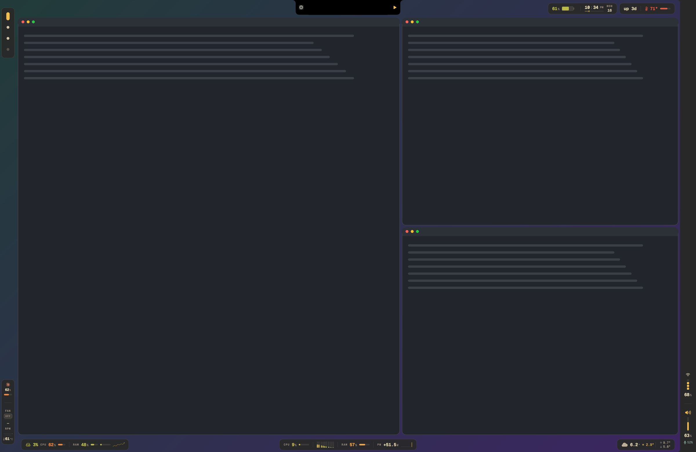
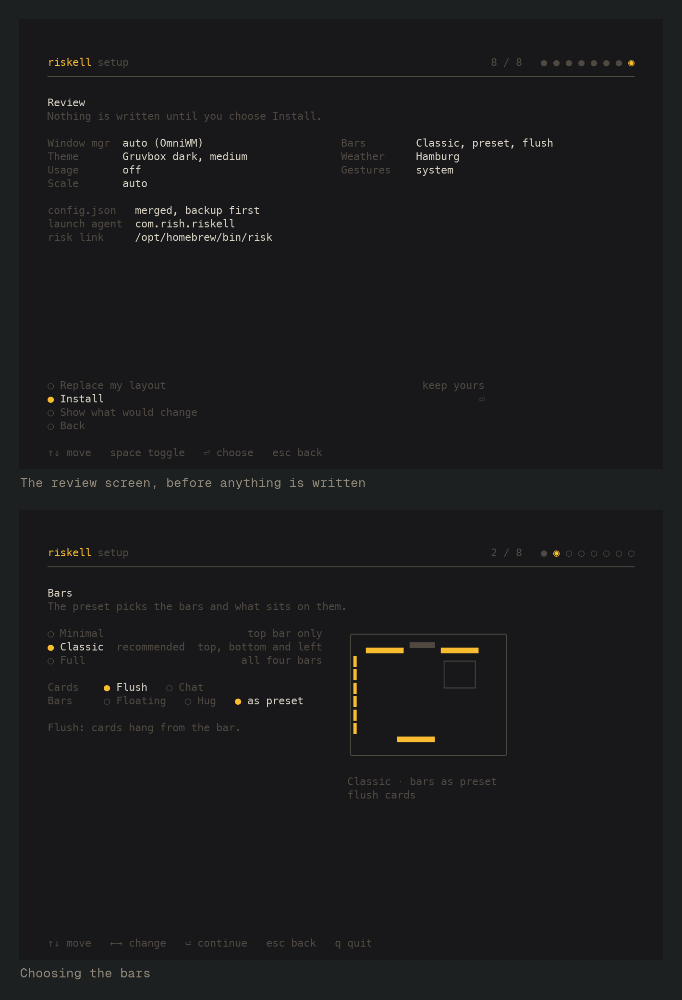
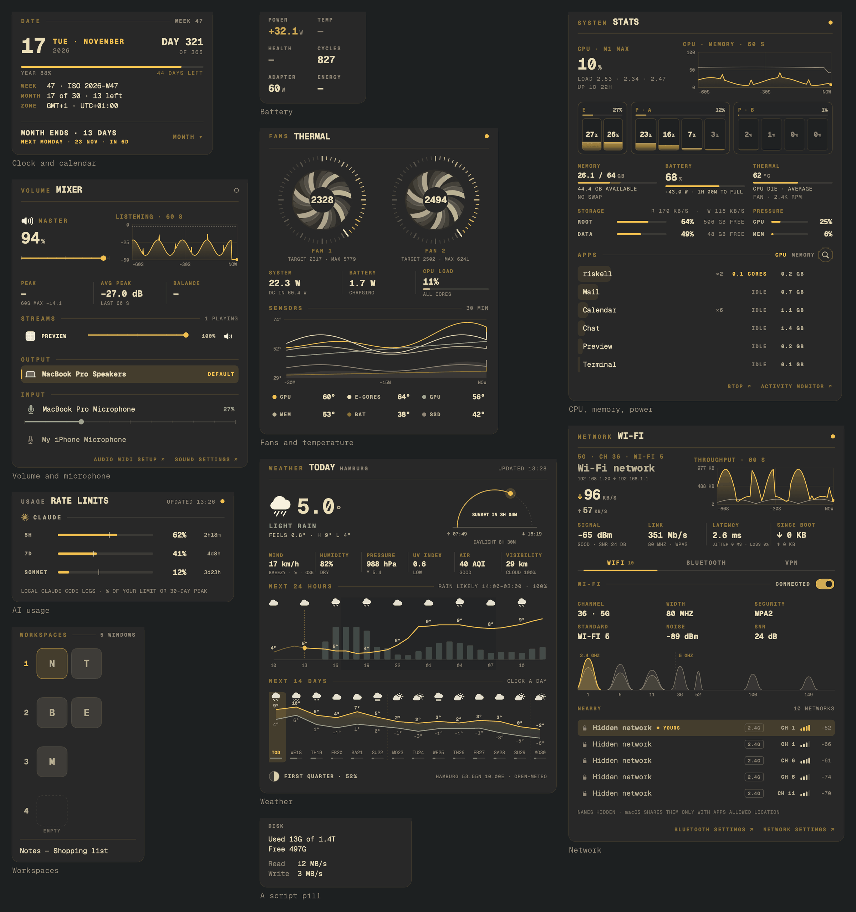
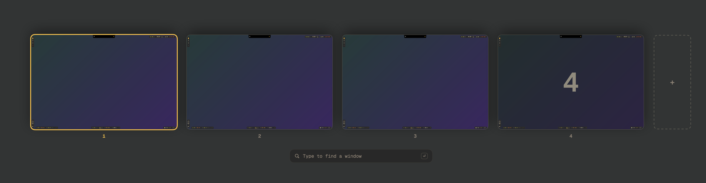
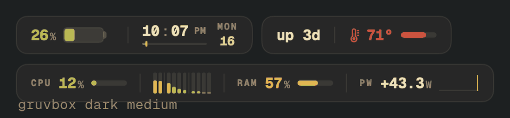
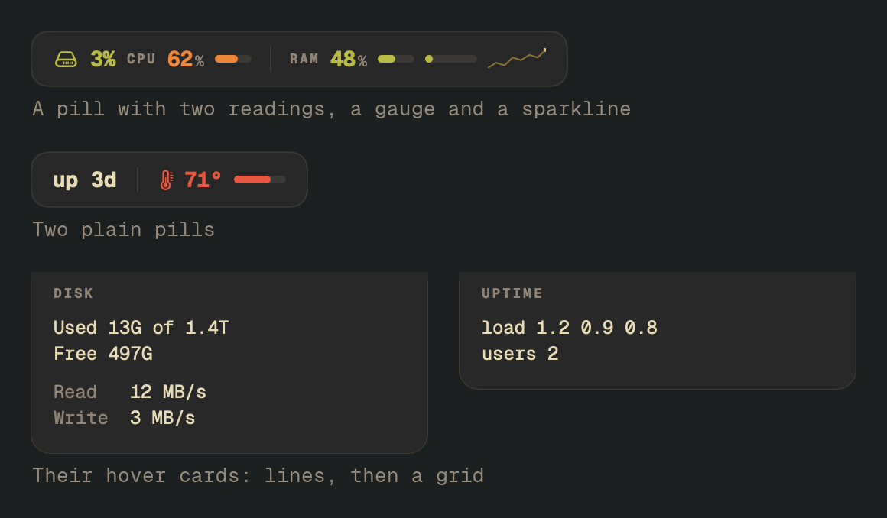
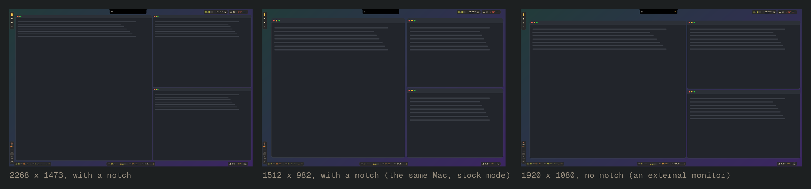
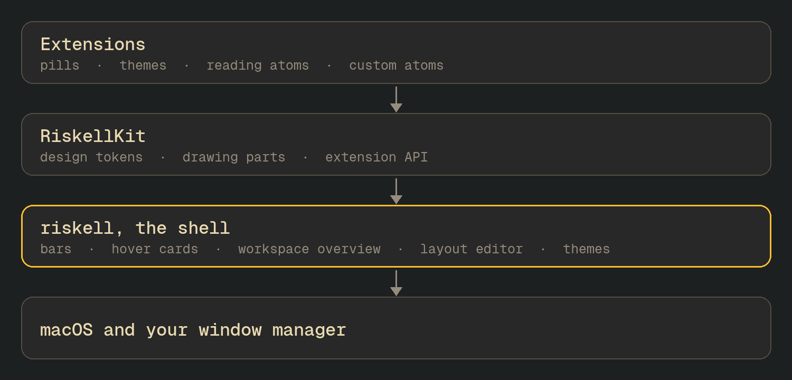
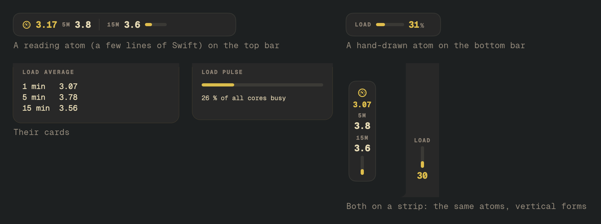

<div align="center">

# riskell

### A desktop shell framework for macOS.

Bars, hover cards, a workspace overview, a layout editor and themes in one native Swift application,<br>
with an extension kit: four ways to add your own, checked by a validator.



<sub>The shell on a 14-inch MacBook Pro. The bars are snapshots of the running application; the windows between them are placeholders.</sub>

<a href="#install">Install</a> ·
<a href="#the-tour">The tour</a> ·
<a href="#what-it-does">What it does</a> ·
<a href="#how-it-is-built">How it's built</a> ·
<a href="#extend-it">Extend it</a> ·
<a href="#run-it">Run it</a> ·
<a href="#what-is-tested">What's tested</a> ·
<a href="#documentation">Docs</a>

<sub><code>v0.1.2</code> &nbsp;·&nbsp; early release, in daily use on one Mac &nbsp;·&nbsp; macOS 14+ &nbsp;·&nbsp; Apple silicon &nbsp;·&nbsp; FSL-1.1-MIT</sub>

</div>

> **Early release.** riskell runs as the real bar on the author's Mac every day. Other Macs, window managers and macOS versions are
> untested, and the extension system is new. [What is tested and what is not](#what-is-tested) lists every case, and
> [docs/UNVERIFIED.md](docs/UNVERIFIED.md) gives the steps to try each one. Reports from other setups are the most useful contribution
> right now.

---

## What it is

On Linux, a desktop shell is a framework: Quickshell or AGS gives you the surface, and you build the bars you want on top of it. On macOS
you mostly get two choices — a bar configured by shell scripts, or widgets written in HTML and JavaScript — and then you keep the result
legible by hand, in every theme, at every scale.

riskell is a desktop shell framework for macOS in the same sense. It began as a port of the author's Quickshell setup on Linux: the bars,
cards, overview and editor are its surfaces, everything on them is an atom, and every atom is a package on a small public kit. The kit owns
the colours, the type and the lengths, so an atom written by a stranger on a different display looks like the ones that ship. A validator
rejects the three ways that usually break: a hard-coded colour, a fixed pixel size, a timer of its own.

| | What it is | How you configure it |
|---|---|---|
| **riskell** | A shell: four bars, hover cards, overview, the layout editor, themes, an extension kit | riskell preferences, JSON, and extensions in Swift, JSON or Base16 |
| [SketchyBar](https://github.com/FelixKratz/SketchyBar) | A top bar on top of the window manager's own machinery | shell scripts |
| [Übersicht](https://github.com/felixhageloh/uebersicht) | Desktop widgets, no bar | React/JSX widgets |
| [SwiftBar](https://github.com/swiftbar/SwiftBar) | Menu bar items from a script's output | one script per item |
| Quickshell, AGS | The same idea as riskell, on Wayland | QML, TypeScript |

It is not a window manager and does not tile windows; it works alongside one. It is not a launcher, and it is not a fixed set of widgets.
[OmniWM](https://github.com/OmniNull/OmniWM) is the reference integration; yabai, AeroSpace and your own scripts work too, and
[each is marked with what it is worth](#window-managers).

---

## Install

```sh
brew tap rish139/riskell
brew trust rish139/riskell              # Homebrew 7 and later refuses an untrusted third-party tap; skip on older versions
brew install riskell
brew install --cask font-geist-mono     # the font the sizes are tuned to
risk install                            # start riskell now and at login (riskell-install for the guided installer)
```

That is the whole install. The formula builds the release from source with Apple's Swift toolchain, takes about a minute, and links `risk`,
the control script. After an upgrade run `risk install` again — the launch agent points into the keg. `brew install --HEAD riskell` builds
the main branch instead.

| Needs | Why |
|---|---|
| macOS 14 or later, Apple silicon | SwiftUI and the private frameworks the shell pins itself with. Intel is not supported. |
| Xcode Command Line Tools (`xcode-select --install`) | Swift; full Xcode is not required. |
| **Geist Mono** | Every size is tuned to it. Without it macOS substitutes another font and the widths move. |
| A tiling window manager | Optional. With one, windows stay clear of the bars; without one, nothing to reserve. |

<details>
<summary><b>From a clone, with the guided installer</b></summary>

```sh
git clone https://github.com/rish139/riskell.git && cd riskell
./install.sh
```



It checks the Mac, asks a few questions, writes the settings and starts riskell. Nothing is written until the final screen. It links `risk`
into a folder on `PATH`; when none is on `PATH` and writable it adds `~/.local/bin` to `~/.zshrc` (and to `~/.bash_profile`, `~/.bashrc`
and fish's `config.fish` when they exist), in a marked block after a backup. `--no-path` skips that, `--uninstall` removes it, `--dry-run`
prints the plan and the JSON it would write, and `--yes` accepts the detected defaults without questions.
[docs/INSTALL.md](docs/INSTALL.md) lists everything it writes.

</details>

<details>
<summary><b>By hand</b></summary>

```sh
swift build -c release
scripts/risk install      # a launch agent: starts at login, restarts if it exits
```

`risk` also provides `dev` (rebuild and restart), `restart`, `log`, `status`, `ext` and `uninstall`; from a checkout that is not installed,
run it as `scripts/risk`. Builds are signed with a local certificate named `riskell-dev` when one exists. Without it macOS treats each
rebuild as a new application and asks again for keychain and Location access.

</details>

---

## The tour

<table>
<tr>
<td width="50%"><br>
<sub><b>Hover cards.</b> Every atom opens one: a calendar, power and health, per-core load, fan dials, a mixer, Wi-Fi and Bluetooth, a forecast.</sub></td>
<td width="50%"><br>
<sub><b>riskell preferences.</b> ctrl-alt-, puts every atom under a dashed outline. Drag it anywhere, including the tray.</sub></td>
</tr>
<tr>
<td><br>
<sub><b>The workspace overview.</b> ctrl-alt-space: one tile per workspace, live window pictures, drag a window between tiles.</sub></td>
<td><br>
<sub><b>Eleven themes.</b> Base16 files, applied live, contrast enforced rather than assumed.</sub></td>
</tr>
</table>

### The atoms that ship

Every one is a package in `Packages/` on the same kit an extension uses — seven packages covering ten atoms — so each is also a worked
example of how to write one.

| Atom | On the bar | In the card |
|---|---|---|
| Workspaces | the window manager's workspaces as a rail of beads | every workspace with its windows; drag to move a window |
| Application icon | the focused application's icon and name | |
| Clock | time, a seconds bar and the date | calendar |
| Battery | charge level and a charging cell | power, temperature, health, cycles, charger, energy |
| CPU | load, per-core bars, memory, power draw | load history, per-core bars, memory, storage, the busiest applications |
| Fan | rpm and temperature | fan dials, temperatures and a 30-minute sensor history |
| Volume | output level and microphone level | output and input devices and a per-application mixer |
| Network | Wi-Fi signal | Wi-Fi details and nearby networks, with Bluetooth and VPN tabs |
| Weather | temperature | hourly and daily forecast ([Open-Meteo](https://open-meteo.com)) |
| AI usage | Claude Code usage from its local logs, when enabled; two opt-in sources (the Claude plan limits, OpenCode Go usage) | token use in the five-hour and seven-day windows; the opt-in sources add their own figures |

Each atom has a horizontal and a vertical form carrying the same data and the same card, laid out for the bar it is on — so any atom can
sit on any of the four bars.

### Script pills

A pill is a widget defined by a command. No Swift, no rebuild: drop a file in `~/.config/riskell/pills/` or name it in `config.json`, and it
appears in the editor's tray ready to place.



```json
{ "id": "vpn", "name": "VPN", "run": "~/bin/vpn-status", "every": 10, "click": "open -a Tunnelblick" }
```

The command prints one line of text, or one line of JSON with `text`, `icon` (an SF Symbol), `tone`, `value` (0 to 1, drawn as a gauge),
`values` (up to three further figures), `spark` (a sparkline), and `lines` for the card — either plain lines or a two-column grid. `every`
is in seconds, minimum 2; `click` runs a command. `watch` re-runs on a file change without polling, and `stream` keeps one long-running
process whose output lines become readings. [docs/PILLS.md](docs/PILLS.md).

### Screen sizes

Every size is a design unit. One scale factor, taken from the height of the notch (or of the menu bar on a Mac without one), turns them
into points — so the picture is the same on a 2268-wide notch screen, a 1512-wide one, and a 1920-wide monitor.



On a notched screen the top bar is split into two wings either side of the notch. A wing shrinks uniformly to 80 % first, and only then
hides its lowest-priority islands; the version pill is never dropped. `riskell --check-fit` prints PASS or FAIL per fake screen without a
second display.

---

## What it does

**Four bars.** Top, bottom, left and right; each is a solid "hug" band with concave corner fillets or a set of floating islands, and the
bottom, left and right can be switched off. Islands hold one or more atoms separated by a hairline, and the start, centre (bottom bar only)
and end zones are filled independently. Gap, edge gap, window gap and corner roundness are adjustable. The bars live in a private SkyLight
space, so they do not slide when the Space changes, and they hide on native full-screen Spaces.

**A notch-aware top bar.** One wing on each side that shrinks, then drops its least important islands, to fit. On a Mac without a notch the
bar sits under the menu bar with a stand-in gap. Now-playing media lives in the wings: the application icon on the left, play and pause on
the right, shown while media plays and for up to 15 minutes after it pauses.

**Windows stay clear of the bars.** A bar cannot reserve screen space on macOS — only the window manager can — so riskell writes the gaps instead of
moving your windows itself, after backing up the settings file the first time. When the number drifts (a second instance, a WM update, a
settings reset) the top bar says `FIX` and names the value it found.

**Version tracking.** riskell records the macOS and OmniWM versions it was last checked against. Anything else gets one pill
in the top bar, only while it differs: `UPDATE DUE · macOS 27.3`, or `FIX · OmniWM workspaceSwipeEnabled = true` for a setting that an
OmniWM update reset. Nothing is drawn when all is as verified.

**Hover cards, two ways.** Flush (hanging from the bar, which fills in beneath the card so the two read as one surface) or chat (a rounded
card joined by a short neck), chosen per bar and stored as `fill` and `chat`. Cards open on hover, pin open with a click, and close on
click-away.

**riskell preferences.** ctrl-alt-, opens it. Every atom gets a dashed outline; atoms are dragged between islands and bars, dropped on an
empty bar to start a new island, and removed with the **x**. The panel sets which bars are on, hug or floating, card style, spacing,
roundness, scale and theme, in collapsible sections, with a reset for each. The atoms and bars are saved to `layout.json`; theme, spacing
and scale to `config.json`.

**Themes with a contrast floor.** Eleven [Base16](https://github.com/tinted-theming/schemes) schemes ship: Gruvbox (dark and light),
Catppuccin (Mocha and Latte), Rosé Pine, Nord, Tokyo Night, Kanagawa, Everforest, Dracula and GitHub Dark High Contrast. A scheme's colours
are not used as given — riskell derives its own tokens and moves text and accents until they clear a contrast floor against the background,
so a faint grey scheme still produces readable text. Any Base16 `.yaml` in `~/.config/riskell/themes/` appears in the picker, and switching
is immediate. `riskell --check-themes` prints the ratios.

**Live settings.** Nearly everything in `config.json` applies live, from kernel file events rather than polling: an edit takes effect within
about a third of a second. `wm`, `scale` and `disabledExtensions` are read at launch.

**Workspaces and windows.** An overview with live window pictures, the focused workspace outlined, a slot for a new workspace,
find-as-you-type, drag-and-drop of windows between workspaces and middle-click to close one. riskell's own bars are drawn inside each tile.
OmniWM is read over its IPC socket with no polling. Optional three-finger gestures: sideways to switch workspace with the rail following the
fingers, up for the overview, plus a scroll guard so the window under the pointer does not move. Gestures that conflict with macOS's own are
detected and reported, one `FIX` pill each.

**Scripting and checks.** A Unix socket; `risk` for install, dev, restart, log, status, extensions and uninstall; a measured efficiency record
with a method for repeating the measurement. One scale factor from the notch or menu bar height, a live display-change observer, fake displays
for testing, and `--check-fit` / `--check-panel` reporting PASS or FAIL.

---

## How it is built

Two parts. The **shell** is the application: it owns every window and draws the surfaces. The **framework** is
[RiskellKit](https://github.com/rish139/riskell-kit), a small Apache-2.0 package in its own repository with the design tokens, drawing
parts and extension API — so anything written against it matches the shell in every theme, at every size.



| Surface | State | What an extension can add |
|---|---|---|
| Bars (top, bottom, left, right) | built | atoms: widgets that sit in islands |
| Hover cards | built | the card an atom opens |
| Workspace overview | built | not yet |
| riskell preferences | built | the EXTENSIONS card: typed settings an extension declares in its manifest |

Five rules hold for the shell and for everything written against the kit:

- **Native.** Swift and SwiftUI. No web view, no second runtime, no second process.
- **Event-driven.** Nothing polls without a reason, and nothing runs for a surface that is not showing.
- **Consistent.** Colour, type and length come from the theme and from one scale factor.
- **Valid by construction.** The API has no way to express an unreadable colour, a fixed pixel size or a stray timer — and the validator
  reports the attempts that get around it, with the fix.
- **Readable by machines.** A JSON Schema, a generated API reference and task-oriented docs let a coding agent write an extension and check
  it without guessing.

---

## Extend it

Four kinds are open today, from no code to custom drawing:

| You want | Kind | Build | Time |
|---|---|---|---|
| a number or text from a command or file | a **pill** | none | minutes |
| new colours | a **theme** (Base16 YAML) | none | minutes |
| a figure, gauge and hover card in Swift | a **reading** atom | yes | an hour |
| your own drawing, in both bar forms | an **atom** | yes | an afternoon |

A **preset** (layout + pills + theme + extensions in one bundle) and a **behaviour** (a background capability) are designed; neither is open
to outsiders yet. [docs/EXTENSION-KIT.md](docs/EXTENSION-KIT.md) has the details.



An extension is a Swift package depending on RiskellKit, compiled into the one binary. No second process: it is native, costs nothing while
its atom is not showing, and receives colours, type and sizes from the kit.

```sh
risk ext new reading my-widget     # scaffold a package
risk ext validate my-widget        # check it; each finding names the fix
risk ext add my-widget             # link it in, rebuild, restart
```

<details>
<summary><b>A reading extension, in full</b></summary>

```swift
import RiskellKit

public enum GpuPackage: RiskellPackage {
    public static var readings: [any ReadingAtom.Type] { [Gpu.self] }
}

public struct Gpu: ReadingAtom {
    public static let meta = AtomMeta(id: "gpu", name: "GPU", priority: 4)
    public init() {}
    public func readings(_ env: Env) -> AsyncStream<Reading?> {
        env.every(.seconds(5)) {
            let load = probe()                       // the extension's own code; nil means nothing usable
            return Reading(text: "\(Int(load * 100))", icon: "cpu", tone: .heat(load), value: load,
                           lines: ["Load \(Int(load * 100)) %"])   // the hover card
        }
    }
}
```

The kit draws the row on a horizontal bar, the column on a strip, the gauge, and the card. A `Reading` has no colour parameter: it carries
a tone (`.ok`, `.warn`, `.crit`, `.accent`, `.heat(x)` and others) and the theme picks the colour. That is why an extension is legible in
every theme without the author testing any.

</details>

<details>
<summary><b>The rules the validator enforces</b></summary>

`risk ext validate` prints `file:line: rule <id>: <what>. Fix: <how>.` once per violation.

- **Colour and type come from the kit** (`Pal`, `T`, a `Tone`). A hard-coded `Color` or font size breaks themes and the type scale.
- **Sizes are design units** (`G.pill`, `G.strip`). An extension never reads the screen, so it renders identically at any resolution.
- **Nothing wakes up on its own.** `Timer`, `DispatchSource` and `Thread` are refused; extensions use `env.every`, `env.watch`,
  `env.on(feed)` or, for an atom that draws itself, `env.repeating`. riskell stops them while the atom is not showing.
- **Both forms are required** for a self-drawn atom, so no atom can be registered without a vertical form.
- **No windows.** riskell owns every window; a card opens through the kit's popout hook.

There is no sandbox and no permission system. A compiled extension runs with your rights, as a Homebrew formula or a shell plugin does —
read the source before you install it, and `risk ext add` shows you what is in it.

</details>

<details>
<summary><b>Sharing one</b></summary>

An extension is a Git repository with a `riskell.json` manifest, and it stays under its author's license and copyright. **Publishing needs
no agreement and no approval**: tag a release, add the GitHub topic `riskell-extension` (or `riskell-theme`, `riskell-preset`), and anyone
can install it with `risk ext add <repository>`.

[riskell-registry](https://github.com/rish139/riskell-registry) is the index: one small JSON file per extension, pinned to a commit, so
nobody can change what you install behind your back. `risk ext publish` checks your repository and prints the listing; CI on the pull
request clones the pinned commit and re-validates it. [docs/STOREFRONT.md](docs/STOREFRONT.md) has the design, and says plainly what the
storefront cannot know — there is no install counter, and there never will be one.

</details>

The documentation is written for people and for coding agents: [AGENTS.md](AGENTS.md) says which kind to choose and the rules,
[docs/WRITING-EXTENSIONS.md](docs/WRITING-EXTENSIONS.md) is the walkthrough, the [API reference](https://github.com/rish139/riskell-kit/blob/main/docs/KIT-API.md)
is generated from the code, the manifest has a [JSON Schema](schemas/riskell-extension.schema.json), and `Examples/load-ext` is a complete
extension.

---

## Run it

| Key | Action |
|---|---|
| **ctrl-alt-,** | open or close riskell preferences |
| **ctrl-alt-space** | open or close the workspace overview |
| three fingers sideways, or up | switch workspace, or open the overview (when [gestures](#gestures) are on) |

Other programs can drive it through a Unix socket:

```sh
printf settings     | nc -U -w1 ~/.cache/riskell/ev.sock   # the editor
printf overview     | nc -U -w1 ~/.cache/riskell/ev.sock   # the overview
printf bar-right-on | nc -U -w1 ~/.cache/riskell/ev.sock   # bar-<bottom|left|right>-<on|off>
printf workspace-3  | nc -U -w1 ~/.cache/riskell/ev.sock   # go to workspace 3
```

| File | What lives there |
|---|---|
| `~/.config/riskell/config.json` | settings: window manager, theme, scale, spacing, location, usage sources, pills. See [docs/CONFIG.md](docs/CONFIG.md). |
| `~/.config/riskell/layout.json` | the layout: which atoms are on which bar, hug or floating, which bars are on. Written by the editor. |
| `~/.config/riskell/pills/*.json` | drop-in script pills |
| `~/.config/riskell/themes/*.yaml` | drop-in Base16 schemes |
| `~/.config/riskell/ext/<id>.json` | values for an installed extension |
| `~/.cache/riskell/` | the event socket and the log |

### Gestures

riskell can read the trackpad directly. Three fingers sideways switch workspace while the rail follows the fingers, three fingers up open
the overview, and scrolls are dropped while three fingers are down so the window under the pointer stays put. Gestures are **off by
default**; `"gestures": "riskell"` turns them on and needs the Accessibility permission, which macOS asks for once. macOS's own three- and
four-finger gestures and OmniWM's workspace swipe must be off, because they act on the same touches — the top bar shows a `FIX` pill for
each one still enabled. The installer can turn the macOS gestures off, and `riskell --gestures-restore --yes` turns them back on.
[docs/GESTURES.md](docs/GESTURES.md).

### Window managers

| `wm` | Status |
|---|---|
| `omniwm` (or `auto` when OmniWM is installed) | In daily use. Workspaces, windows and focus over its IPC. riskell keeps its `gaps.outer` in step with the bars that are on, after a backup on the first change. |
| `yabai` | Written from yabai's documentation. **Not tested.** |
| `aerospace` | Written from AeroSpace's documentation. **Not tested.** |
| `command` | Your own scripts: one prints the state as JSON, others handle focus, move and close ([docs/WM-COMMAND.md](docs/WM-COMMAND.md)). The state side is tested; the actions are not. |
| `none` | Bars without workspaces. |

### Resource use

About 1 % of one core at idle on the reference layout (0.3 s of CPU per 30 s), about 105 MB resident, 8 threads. All work is event-driven:
file events, sockets, notifications. The timers that remain are the clock's seconds bar (1 s), the CPU atom (2 s), a 2 s system sampler, a
10 s fan read, and a 5 s picture-in-picture safety net. Everything an atom starts — all of them packaged, plus pills and readings — runs only
while its bar is showing, so a bar that is off, or hidden by a full-screen Space, stops it, and an atom that is not placed starts nothing: no
timer, no listener, no request, no permission prompt. The numbers, the profile and the method are in [docs/EFFICIENCY.md](docs/EFFICIENCY.md).

### Data access

| What | Detail |
|---|---|
| Network | Weather from Open-Meteo, only when a location is set (your coordinates go to Open-Meteo). The installer makes one city lookup against its geocoding service while you type the name. `risk ext search`, `add` and `update` fetch the registry index from GitHub Pages and clone the repositories you install from. Opt-in only: `usage.claudeLimits` sends the Claude Code token to Anthropic's usage endpoint (unofficial); `usage.opencode` sends the OpenCode session cookie to opencode.ai's console. Nothing else. |
| Local logs | Claude Code usage reads token counts from Claude Code's own session logs (`*.jsonl` under `~/.claude/projects`), only when enabled. It reads no credentials and sends nothing. |
| Keychain | Off by default. `usage.claudeLimits` (unofficial) reads the Claude Code login token to ask Anthropic for your plan's real limits. Anthropic's terms do not allow that token in other tools, so the account could be restricted. |
| Browser data | Off by default. `usage.opencode` reads the opencode.ai session cookie from a browser profile (Zen by default) to show your OpenCode Go usage. |
| Accessibility | Only for the optional gestures and the scroll guard. |
| Location | Only so that macOS will give up Wi-Fi network names. |
| Files | riskell writes `~/.config/riskell/`, backs up OmniWM's `settings.toml` before the first gap change, and, with gestures on, can change two trackpad and Dock settings after saving the originals. |

No telemetry, no analytics, no accounts. The only things that leave the machine are the requests above, and only for options you turned on
or commands you ran. Your settings stay in `~/.config/riskell/` and are never part of the source.

---

## What is tested

| Level | Detail |
|---|---|
| **In daily use** | One Apple-silicon MacBook Pro 14-inch (M1 Max), macOS 27.2 (26B123), OmniWM 0.8.0 (IPC protocol 22): bars, atoms and cards, the editor, themes, pills, the overview, OmniWM integration and the three-finger swipe. |
| **Checked numerically and by rendered pictures** | Other screen sizes and scales, and screens without a notch, using fake displays (`riskell --check-fit`, `--check-panel`). |
| **Written, not tested** | The yabai, AeroSpace and command backends; macOS 14 and 15; a clean-machine install; connecting or disconnecting a monitor while running; dragging windows in the overview at other scales. |

[docs/UNVERIFIED.md](docs/UNVERIFIED.md) lists each one with the steps to try it.

riskell depends on macOS interfaces that are not public and can change in any update: SkyLight (pins the bars in a private space),
MultitouchSupport (the swipe) and MediaRemote (now playing, read through the system `perl`). That is what the `UPDATE DUE` pill watches.
[docs/COMPATIBILITY.md](docs/COMPATIBILITY.md) lists every dependency and the checklist to walk after an update.

---

## Planned

Nothing here is a commitment and the order is not fixed; [docs/ROADMAP.md](docs/ROADMAP.md) has the reasoning.

**Next**
- [ ] `risk` as a product surface: `risk doctor`, `risk ctl`, `risk snap`, `risk bench`, `risk config`, `risk wm`, and completions
  ([docs/ROADMAP.md](docs/ROADMAP.md)).
- [ ] Import and portability: BitBar/SwiftBar and Waybar import, Omarchy themes and bar widgets, `derivedFrom` provenance.

**Before a wider release**
- [ ] Testing on other Apple-silicon Macs and macOS versions (14 and 15), and with yabai and AeroSpace.
- [x] A Homebrew tap: `brew tap rish139/riskell && brew install riskell`, then `risk install`.

**Framework**
- [x] A registry and storefront: `risk ext search`, `add`, `update`, `publish`, with
  [riskell-registry](https://github.com/rish139/riskell-registry) as the index — listings pinned to a commit, GitHub as the backend, one
  static page. The atoms that ship with riskell are its first listings. Still to do: presets, CI that renders each extension on several
  displays, bars and themes, and an in-app browse card.
- [x] riskell preferences: the layout editor renamed, and typed settings declared in a manifest appear in its EXTENSIONS card, so an
  extension needs no settings interface of its own.
- [ ] Preset bundles (layout, pills, theme and extensions together) and `risk ext preset apply`.
- [ ] Background-behaviour extensions from outside the application, with a review policy.

**Shell**
- [x] Every atom is a package on the kit, and nothing runs for an atom that is not on a bar that is on.
- [ ] The notch beyond media: a shelf, quick actions and timers.
- [ ] Draw the clock's seconds bar and the CPU deck with Core Animation layers (about 0.8 % of a core).

---

## Troubleshooting

<details>
<summary><b>A gap appears on the right and the top bar shows <code>FIX · OmniWM right gap = …</code></b></summary>

riskell sets the outer gaps in OmniWM's `settings.toml` to match the bars that are on; a bar that is off leaves a 6-point margin. When the
file holds a different value — usually a second riskell process wrote its own — the `FIX` pill shows the value it found. Restoring the
number under `[gaps.outer]` in `~/.config/omniwm/settings.toml` fixes it, and OmniWM applies the change immediately.

A second instance started for testing must be given `--no-reserve` as a separate argument; that keeps it out of OmniWM's gaps. The harness
in [docs/BARS.md](docs/BARS.md) passes it.

</details>

<details>
<summary><b>Text looks wrong or too wide</b></summary>

Install Geist Mono (`brew install --cask font-geist-mono`) and restart riskell. Without it macOS substitutes another font.

</details>

<details>
<summary><b>macOS keeps asking for keychain or Location access after a rebuild</b></summary>

A rebuild without a stable signature looks like a new application to macOS. Create a self-signed code-signing certificate named
`riskell-dev` in the login keychain (Keychain Access ▸ Certificate Assistant) and `scripts/risk` will sign with it.

</details>

<details>
<summary><b>The bars do not appear</b></summary>

`scripts/risk status` shows whether the launch agent is running, and `scripts/risk log 50` prints the last 50 lines. A second full instance
cannot start while another holds the lock (`~/.cache/riskell/riskell.lock`); instances started with `--snap`, `--dump` or `--no-reserve` are
exempt.

</details>

<details>
<summary><b>Gestures do nothing, or macOS and riskell both respond</b></summary>

Look for `FIX · gesture: …` pills in the top bar; each names a setting still enabled that conflicts with the swipe. The scroll guard needs
the Accessibility permission, and until it is granted riskell retries every 3 seconds.

</details>

---

## Documentation

| Topic | Files |
|---|---|
| Using it | [BARS](docs/BARS.md) (bars, layout, editor, snapshots) · [CONFIG](docs/CONFIG.md) · [PILLS](docs/PILLS.md) · [THEMES](docs/THEMES.md) · [GESTURES](docs/GESTURES.md) · [INSTALL](docs/INSTALL.md) |
| Window managers and compatibility | [COMPATIBILITY](docs/COMPATIBILITY.md) · [WM-COMMAND](docs/WM-COMMAND.md) · [UNVERIFIED](docs/UNVERIFIED.md) |
| Extending | [AGENTS](AGENTS.md) · [WRITING-EXTENSIONS](docs/WRITING-EXTENSIONS.md) · [KIT-API](https://github.com/rish139/riskell-kit/blob/main/docs/KIT-API.md) · [EXTENSION-KIT](docs/EXTENSION-KIT.md) · [STOREFRONT](docs/STOREFRONT.md) |
| Working on it | [ARCHITECTURE](docs/ARCHITECTURE.md) · [EFFICIENCY](docs/EFFICIENCY.md) · [ROADMAP](docs/ROADMAP.md) · [CONTRIBUTING](CONTRIBUTING.md) |

The pictures in this document are produced by `scripts/make-screenshots` from fake data, so they can be regenerated after a change.

## License

The application is under the [Functional Source License 1.1, MIT Future License](LICENSE) (`FSL-1.1-MIT`): use it for anything, including
at work, except shipping a product that replaces it; each release becomes MIT two years after it ships. [LICENSING.md](LICENSING.md) puts
that in a table and says what a commercial license covers. [RiskellKit](https://github.com/rish139/riskell-kit), `risk ext`, the manifest
schema and the examples are Apache-2.0; an extension keeps whatever license its author chooses; colour schemes are credited in
[THIRD-PARTY-NOTICES.md](THIRD-PARTY-NOTICES.md). Releases `0.1.0`–`0.1.2` were PolyForm Noncommercial and stay under it.

Contributing: [CONTRIBUTING.md](CONTRIBUTING.md) (a one-time [CLA](CLA.md) for the application only; nothing for extensions or the
Apache-2.0 parts), the [Code of Conduct](CODE_OF_CONDUCT.md), and private vulnerability reports in [SECURITY.md](SECURITY.md).
